# Math Workshop (Mathémagique) : manuel en français

> **Copy à valider.** Ce fichier est la copie, pour relecture, du texte de `original/mathemagique/MANUEL.html` (la page web liée depuis l'écran titre du jeu) : même contenu, mêmes titres. Tout le texte est nouveau et doit être validé. Les illustrations (`original/mathemagique/manuel/*.png`) sont des captures du jeu faites par `scripts/mathemagique/manual-images.mts`. Ce manuel est écrit pour la version de 1994 que nous réimplémentons ; il s'appuie sur le manuel anglais de la version de 1997 (transcription : `manual-en.md`) et sur l'étude du jeu (`screens/*.md`), sans reprendre le texte du manuel d'origine.
>
> Tout ce qui suit le repère `<!-- manuel -->` est le contenu de la page. Textes de la page qui n'en font pas partie : en-tête « Broderbund, 1994 » / « Math Workshop (Mathémagique) » / « Manuel en français », sommaire (les titres de section), lien « Aller au contenu » (accessibilité), pied de page « Manuel réécrit pour la version de 1994 de Math Workshop (réimplémentation de fan). Les illustrations sont des captures du jeu. », titre d'onglet « Math Workshop (Mathémagique) : manuel ».

<!-- manuel -->

*Le texte du jeu et les voix sont en anglais : les noms des boutons, des activités et des personnages restent ceux qui s'affichent à l'écran.*

## Présentation

**Math Workshop** (affiché « Math Workshop (Mathémagique) ») est un jeu éducatif de maths pour enfants, édité par Broderbund en 1994 sur CD-ROM pour Windows. Cette page décrit la version anglaise, jouée ici dans le navigateur.

Vous êtes chez **Poly Gonzales**, qui dirige l'atelier. Dans sa salle de contrôle, chaque objet du décor ouvre une activité :

- un bowling où un gorille, **Gus**, lance ses boules quand on répond juste (calcul, fractions, estimation) ;
- une boutique de rythmes où l'on découpe des fractions de mesure pour reconstituer des morceaux, devant **Algebird**, un oiseau qui danse ;
- un vitrail à peindre, avec dix motifs ;
- trois sortes de puzzles : des photos cachées, des tableaux à motifs et des dessins faits de traits ;
- un jeu de fusées, où l'on affronte Poly au jeu de Nim.

On y travaille, sans le dire, les opérations, les fractions, l'estimation, les motifs, l'orientation dans l'espace et la logique. Il n'y a pas de « game over » : on peut recommencer autant de fois qu'on veut.

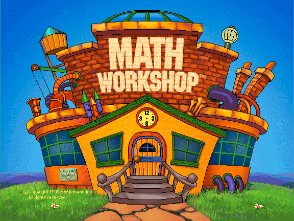
*L'écran titre.*

## Démarrer

### L'écran titre

Au premier lancement, le logo « Brøderbund présente » s'affiche d'abord (un clic ou une touche le passe). Puis l'écran titre : **cliquez sur la porte** pour entrer. Si vous ne faites rien, la porte s'ouvre toute seule à la fin de la musique. L'horloge de la façade indique l'heure de votre ordinateur.

La plaque en bas à gauche ouvre les **crédits** ; le bouton EXIT y ramène à l'écran titre.

### Se connecter

En entrant, Poly vous accueille et le **moniteur de connexion** monte devant vous. C'est lui qui retient qui joue : les niveaux réussis au bowling, les vitraux peints et les morceaux du Rhythm Shop sont gardés par joueur.

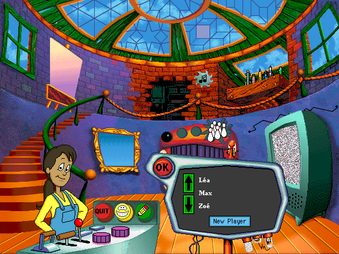
*Le moniteur de connexion : trois noms visibles, des flèches pour parcourir la liste, New Player et OK.*

- **Nouveau joueur** : cliquez sur **New Player** (si la liste est vide, la saisie commence directement), tapez le prénom (28 caractères au plus, accents acceptés) puis cliquez sur **OK** ou appuyez sur Entrée. Un prénom déjà pris est refusé.
- **Joueur existant** : parcourez la liste avec les flèches, cliquez sur le nom (ou double-cliquez), puis **OK**. Les noms sont rangés par ordre alphabétique.
- **Changer de joueur en cours de route** : bouton **Sign-in** (le crayon) sur le pupitre de Poly, ou clic sur l'étiquette du nom dans le Bowling et dans Pattern Windows.

Sans joueur connecté, un clic sur une activité fait demander à Poly de se connecter d'abord.

Les joueurs (40 au plus) et leurs progrès sont enregistrés **dans le navigateur de cet appareil** : ils ne suivent pas d'un appareil, ni d'un navigateur, à l'autre, et disparaissent si vous effacez les données du site.

### Les préférences

Elles ne sont pas affichées par un bouton : **Ctrl + clic sur Sign-in** (sur écran tactile, un appui long, voir « Sur mobile »).

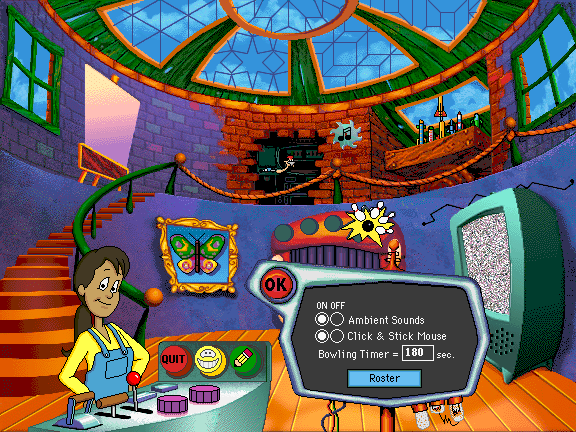
*Les préférences : Ambient Sounds, Click & Stick Mouse, Bowling Timer et le bouton Roster.*

- **Ambient Sounds** : la musique de fond et les bavardages de Poly dans l'atelier (ON / OFF). Les bruitages et les voix des activités ne sont pas concernés.
- **Click & Stick Mouse** : pour déplacer une pièce, on **clique pour la prendre, puis on clique pour la poser** (réglage d'origine, plus simple pour les petites mains). Désactivé, il faut **glisser** la pièce en gardant le bouton enfoncé.
- **Bowling Timer** : le temps donné, en secondes, pour réussir une série au Bowling, de 1 à 999 (180 par défaut). Une valeur hors de cette plage est ignorée.
- **Roster** : la liste des joueurs. Elle permet d'en ajouter (**Add**) ou de supprimer le joueur sélectionné (**Delete**) ; **Preferences** revient aux réglages.

Les réglages sont communs à tous les joueurs de l'appareil.

## La salle de contrôle (Control Room)

C'est l'écran d'accueil de l'atelier. **Cliquez sur un objet du décor** pour lancer l'activité correspondante.

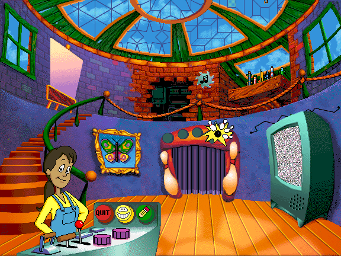
*La salle de contrôle.*

| Objet | Activité |
|---|---|
| Le rideau en forme de gueule rouge, aux quilles | **Bowling for Numbers** |
| Le trou dans le mur, avec un engrenage et une note de musique | **Rhythm Shop** |
| La verrière en vitrail, au plafond | **Pattern Windows** |
| La télévision | **Hidden Picture Puzzles** |
| Le cadre au papillon | **Puzzle Patterns** |
| Le chevalet, à gauche | **Super Sticklers** |
| L'étagère aux fusées, à droite | **Rockets** |

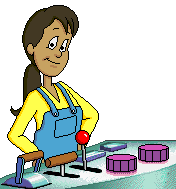

**Poly** est la jeune responsable de l'atelier. **Cliquer sur elle** lance une *Math Trivia* : un petit dessin humoristique sur un fait mathématique, avec son histoire racontée par Poly (19 au total, sans répétition tant qu'elles n'ont pas toutes été vues). Un clic sur l'image ou sur Poly la raconte à nouveau ; **OK** referme le moniteur.

Le **pupitre** de Poly porte trois boutons :

- **Quit** (rouge) : un sifflet apparaît ; cliquez dessus pour quitter et retourner à l'accueil du site, ou cliquez ailleurs pour rester. Ctrl + Q quitte directement ;
- **Help** (le visage souriant) : Poly vient expliquer. Cliquez ensuite sur n'importe quel objet pour entendre ce qu'il fait ; un clic pendant une explication l'interrompt ; cliquez sur **Poly** pour quitter l'aide. La première fois, Poly explique d'elle-même tout le fonctionnement ;
- **Sign-in** (le crayon) : changer de joueur (avec Ctrl, les préférences).

D'autres éléments du décor réagissent au clic, simplement pour le plaisir : les fenêtres, la rampe de l'escalier et les leviers du pupitre (qui figent ou relancent certaines animations).

Dans toutes les activités, **Exit** (rouge) ramène à la salle de contrôle et **Help** (un visage souriant) fait venir Poly, qui explique chaque élément de l'écran quand on clique dessus. Un clic sur Poly, ou sur la main « stop », referme l'aide.

## Bowling for Numbers

> **But** : répondre juste à dix questions pour que Gus lance un **strike**, puis réussir dix strikes pour finir un niveau.

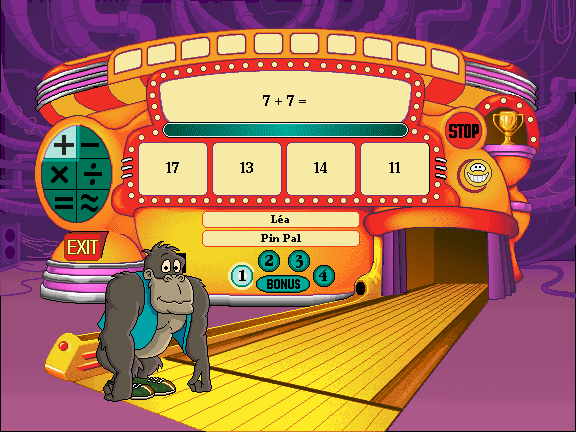
*Le Bowling : la question, les quatre réponses, la barre de temps, les niveaux, votre nom et votre rang.*

**Comment jouer**

1. Choisissez le **type de questions** avec les six boutons de gauche :
   - **+ − × ÷** : addition, soustraction, multiplication, division ;
   - **=** : fractions équivalentes (on reconnaît la même quantité sous des dessins différents) ;
   - **≈** : estimation (« About how many… ? », par exemple combien de *pinheads* de large mesure un *toothpick*).
2. Choisissez un **niveau**, de **1** à **4**, ou **BONUS**. Le bonus ne s'ouvre pour un type de questions qu'une fois ses quatre niveaux réussis.
3. Cliquez sur **GO!**. Le bouton devient **STOP** (pour arrêter la partie).
4. Une question s'affiche, avec **quatre réponses** : cliquez sur la bonne, ou appuyez sur **1, 2, 3 ou 4**.
5. **Dix bonnes réponses** (pas forcément de suite) font un **strike** : Gus lance sa boule et un témoin s'allume en haut de la machine (le « Strike Zone »). **Dix strikes** terminent le niveau : un ruban est gagné et le rang monte.

**À savoir**

- La **barre de temps** montre le temps qu'il reste pour donner les dix réponses de la série en cours (180 secondes, réglable dans les préférences). Quand il est écoulé, Gus est déçu mais **les strikes déjà obtenus sont conservés**.
- Une **mauvaise réponse** ne coûte rien : la bonne réponse est montrée, puis une nouvelle question arrive. Une question ratée peut revenir un peu plus tard.
- Dans un même niveau, les questions se corsent peu à peu au fil des strikes.
- Le jeu retient, pour chaque type de questions, le niveau en cours et les strikes obtenus.
- Cliquez sur l'étiquette du nom pour changer de joueur, sur Gus pour le voir réagir, et sur le **trophée** pour voir le Hall of Fame.

**Les rangs.** Votre rang, affiché sous votre nom, monte d'un cran à chaque niveau terminé (de 1 à 4, pour chacun des six types de questions ; le bonus ne compte pas). Il y a **25 rangs** :

1. Rookie Roller
2. Ball Polisher
3. Twinkle Toes
4. Gutter Nut
5. Cereal Bowler
6. Lane Brain
7. Alley Duster
8. Toe Jammer
9. Spare Ribber
10. Pin Pal
11. Spare Splitter
12. Alley Cat
13. Bowl Fighter
14. Slammin' Slider
15. Bowlmeister
16. Side Splitter
17. Steam Roller
18. Alley Rapper
19. King Pin
20. Strikenator
21. Super Bowler
22. Pin Crusher
23. Star Shooter
24. Pin Wizard
25. Strike Master

**Pour l'estimation (≈).** Les questions portent sur des longueurs, des durées et des poids, avec des unités parfois cocasses (des *pinheads*, des *sugar cubes*, des *cans of soda*, des *cats*…). Quelques repères utiles : 1 inch = 2,54 cm ; 1 foot = 12 inches ; 1 yard = 3 feet ; 1 ounce ≈ 28 g ; 1 pound = 16 ounces ; 1 kilogram ≈ 2,2 pounds ; 1 minute = 60 secondes ; 1 hour = 3 600 secondes ; 1 day = 86 400 secondes ; 1 month ≈ 30,4 jours ; 1 year = 365 jours dans le jeu.

*Il n'y a ni série personnalisée (Custom Play) ni suivi de pourcentages dans cette version : pour suivre les progrès, voir le Hall of Fame.*

## Rhythm Shop

> **But** : reconstituer le rythme d'un morceau en fabriquant les bonnes **fractions de mesure**, pour faire danser **Algebird**.

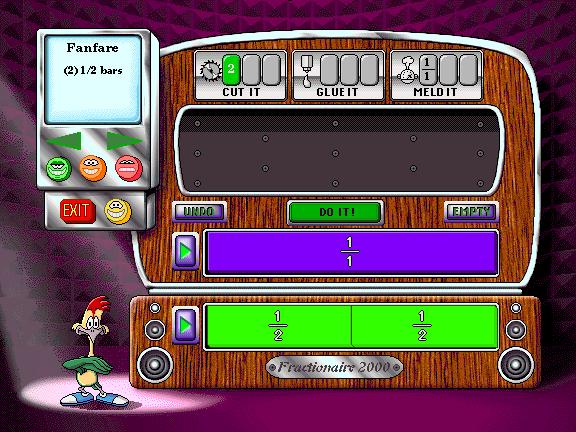
*Le Rhythm Shop : le Teletune (en haut à gauche), les trois outils, le Fractionator, le Parts Bin (la barre entière) et le Pattern Bin (le motif à remplir).*

**Comment jouer**

1. Choisissez un niveau avec les trois **visages** (Level Brothers), puis un morceau avec les **flèches** du **Teletune**, l'écran en haut à gauche. Il affiche le nom du morceau et sa « recette », par exemple *Fanfare (2) 1/2 bars* : deux moitiés de mesure. Il y a **45 morceaux**, 15 par niveau.
2. Le **Pattern Bin** (le bac du bas) montre les emplacements à remplir, avec leur taille. Le **Parts Bin** (juste au-dessus) contient au départ la barre entière, **1/1**.
3. Prenez une pièce et déposez-la dans le **Fractionator**, la zone du milieu, où se font les transformations.
4. Choisissez un **outil** (voir ci-dessous) puis cliquez sur **DO IT!** (le bouton clignote quand l'opération est possible).
5. Glissez les pièces obtenues dans les emplacements du Pattern Bin, dans le bon ordre. Une pièce déjà posée peut être reprise.
6. Quand tous les emplacements sont remplis, la machine joue le morceau en entier, Algebird danse et une petite animation de félicitations suit. La prochaine fois, le même morceau revient avec le même motif, mais d'**autres réglages d'outils** à utiliser.

**Les trois outils**

- **Cutter** coupe une pièce en parts égales (le réglage donne le nombre de parts : 2, 3, 4…). Il n'y a qu'une pièce à la fois dans le Fractionator. Impossible de couper en parts plus petites que 1/16, ni en parts qui ne tombent pas juste.
- **Gluer** colle plusieurs pièces **de même taille** en une seule plus grande.
- **Melder** (« fusionner ») réunit des pièces **de tailles différentes** en une seule de la taille indiquée : par exemple 1/4 + 1/8 donnent 3/8.

**Les autres boutons**

- **UNDO** annule la dernière opération tant que les pièces sont dans le Fractionator ; **EMPTY** renvoie toutes les pièces du Fractionator dans le Parts Bin.
- Les deux boutons ▶ (**Play Parts**, **Play Pattern**) font écouter : le premier le rythme des pièces du Parts Bin, le second le morceau avec les emplacements déjà remplis. Algebird ne danse que si le motif est complet.
- Si une opération est impossible, **Algebird** vous le fait comprendre par une petite réplique. Cliquez sur lui pour le voir réagir.

Il n'y a ni score ni limite de temps.

## Pattern Windows

> **But** : peindre à son goût un vitrail, avec **dix motifs** et **15 couleurs**.

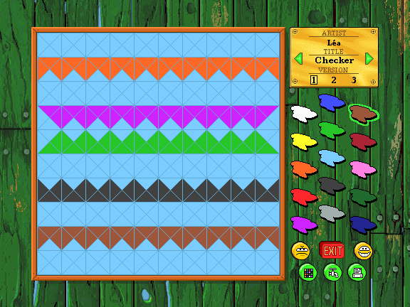
*Pattern Windows : le vitrail à gauche ; à droite la plaque dorée (nom, titre du motif et version), la palette et les boutons.*

**Comment jouer**

- Cliquez sur une **couleur** de la palette, puis **cliquez** ou **glissez** dans le vitrail : chaque pièce touchée prend cette couleur. Cliquer de nouveau sur une pièce déjà de la couleur choisie l'efface (elle reprend sa couleur d'avant).
- Les **flèches** de la plaque dorée changent de motif : *Checker, Triangles, Crosses, Stars, Links, Lace, Cubes, Turtle Shell, Hooks, Circles*.
- Les **numéros de version 1, 2 et 3** permettent de garder jusqu'à **trois peintures par motif**, par joueur. Tout est enregistré automatiquement.
- Sous la palette, de gauche à droite : **Kaléidoscope** (les couleurs défilent quelques secondes dans le vitrail), **Faucet** (le robinet : peint tout le vitrail de la couleur choisie ; avec le blanc, il efface tout) et **Print**. Au-dessus : **Yuck!** annule la dernière peinture (cliquez de nouveau pour la rétablir), **Exit** et **Help**.
- **Print** n'imprime pas : il **télécharge une image PNG** du vitrail.
- Les touches **x** et **z** passent à la couleur suivante ou précédente.

**Idées de Poly** : combien de formes différentes voyez-vous dans chaque fenêtre ? Combien faut-il de couleurs, au minimum, pour que deux pièces voisines n'aient jamais la même ? Peignez un motif qui se répète, puis lancez le Kaléidoscope !

## Hidden Picture Puzzles

> **But** : remplir exactement l'écran de la télévision avec des pièces, pour faire apparaître une photo cachée.

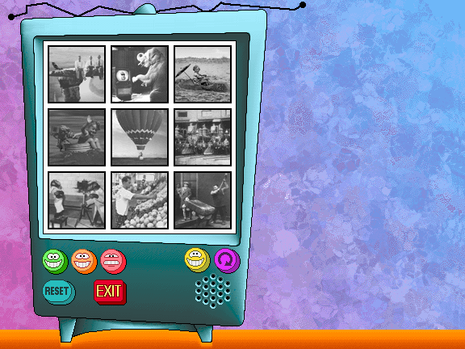
*Le menu : neuf photos en noir et blanc, les trois visages de niveau, Help, Rotate, Reset et Exit.*

**Comment jouer**

1. Choisissez un niveau avec les **visages** (Level Brothers) : **vert** (écran de 4 × 4 carrés), **orange** (5 × 5) ou **rouge** (6 × 6). Cliquez ensuite sur une des **neuf photos**.
2. La télévision découpe l'écran en pièces de 1 à 7 carrés et les éparpille à droite.
3. Prenez une pièce, déplacez-la, **tournez-la** avec le bouton **Rotate** ou la touche **Espace** (quart de tour, dans le sens des aiguilles d'une montre) et posez-la sur l'écran. Proche de la grille, elle s'y **aimante**, à condition de ne pas en recouvrir une autre. Une pièce posée se reprend par un clic.
4. Chaque pièce posée révèle la partie de la photo qu'elle recouvre. Quand toutes sont en place, un petit air joue et la **photo s'anime**. Cliquez sur la télévision pour la revoir.

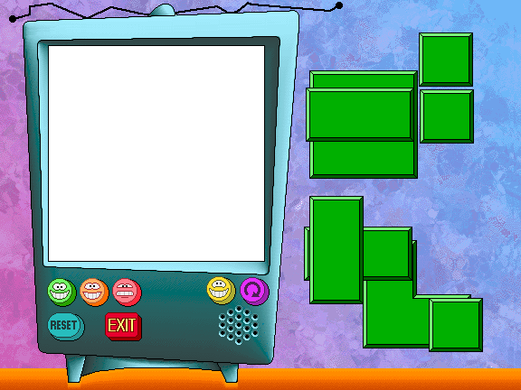
*Un puzzle commencé : les pièces sont à droite.*

**À savoir**

- Rotate agit sur la dernière pièce prise, même lâchée.
- **Reset** éparpille de nouveau les pièces, avec le même découpage. En rechoisissant la même photo, le découpage change.
- Chaque puzzle a plusieurs solutions. Il n'y a ni score ni minuteur.

## Puzzle Patterns

> **But** : reconstituer un tableau en plaçant huit pièces dans le cadre, en s'aidant du motif du cadre.

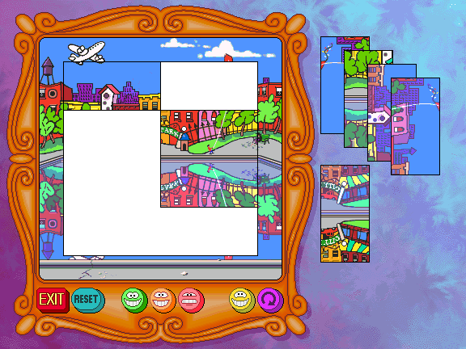
*Puzzle Patterns : le cadre au centre, les pièces à droite, la barre de boutons en bas.*

**Comment jouer**

1. Choisissez un niveau avec les trois **visages** : trois menus de **neuf tableaux**, soit 27 puzzles, du plus simple (vert) au plus difficile (rouge). Cliquez sur un tableau.
2. Le cadre de 4 × 4 carrés reste vide, et les **huit pièces rectangulaires** (deux carrés chacune) sont empilées à droite, parfois la tête en bas.
3. Prenez une pièce, tournez-la au besoin (**Rotate** ou **Espace**) et déposez-la dans le cadre, où elle s'aimante.
4. Le puzzle est réussi quand les huit pièces sont à leur place, dans le bon sens : le tableau **s'anime** (cliquez dessus pour le revoir).

**Le cadre est un indice** : son motif se répète dans l'image. Regardez-le bien avant de commencer. Triez les pièces par couleur ou par sens, remettez les personnages à l'endroit, et appariez les bords entre eux.

Les boutons : **Exit**, **Reset** (mélange de nouveau les pièces du même puzzle), les trois niveaux, **Help** (Poly) et **Rotate**. Il n'y a ni score ni minuteur.

## Super Sticklers

> **But** : recoller des **traits** pour refaire un dessin, qui s'anime une fois terminé.

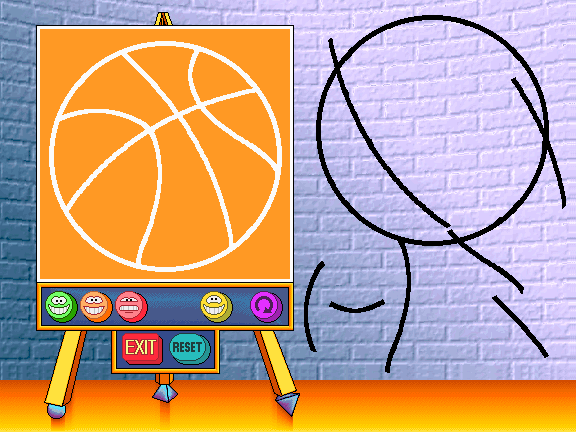
*Super Sticklers (niveau vert) : le chevalet à gauche, les traits à droite.*

**Comment jouer**

1. Choisissez un niveau avec les **visages**, puis un dessin parmi les **neuf** du menu (27 en tout).
2. Les **traits** (*Sticky Lines*) sont éparpillés à droite. Prenez-en un, tournez-le au besoin (**Rotate** ou **Espace**) et posez-le sur le chevalet, sur le dessin à refaire. Un trait bien placé et bien orienté se **colle** de lui-même.
3. Quand tous les traits sont collés, le dessin s'anime (cliquez sur le chevalet pour le revoir).

**Les niveaux changent l'aide donnée :**

- **Vert** : le dessin est tracé en blanc sur le chevalet ; il suffit de le recouvrir ;
- **Orange** : la moitié du dessin est déjà tracée en noir ; le reste n'apparaît qu'en silhouette ;
- **Rouge** : on ne voit que la silhouette, avec une **petite image du dessin terminé** en haut à droite, pour s'y référer.

**Reset** remet tous les traits en vrac. Il n'y a ni score ni minuteur.

## Rockets

> **But** : lancer **la dernière fusée**. C'est un jeu de **Nim** contre Poly (ou contre un ami).

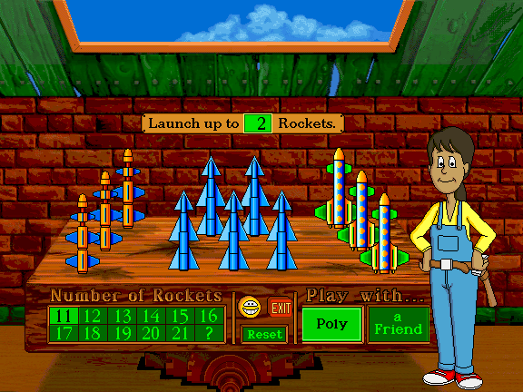
*Rockets : le panneau « Launch up to… Rockets » en haut, le pavé « Number of Rockets » et les boutons Poly et a Friend en bas.*

**Comment jouer contre Poly**

1. Choisissez le **nombre de fusées**, de **11 à 21**, avec le pavé (le **?** en tire un au hasard).
2. Le panneau **Launch up to… Rockets** indique le **nombre maximal de fusées** qu'on peut lancer à chaque tour, de 2 à 5. Cliquez dessus pour le changer, **avant** la partie ou après (pas pendant).
3. À tour de rôle, on **clique sur des fusées** pour les lancer : de 1 jusqu'au maximum du tour. Pour que Poly commence, cliquez d'abord sur **elle**.
4. Quand vous avez lancé le maximum, Poly joue toute seule. Si vous en avez lancé moins, **cliquez sur Poly** pour lui passer la main (au moins une fusée doit être partie).
5. Celui qui lance **la dernière fusée** gagne.

**À savoir**

- Poly s'adapte : plus vous gagnez, mieux elle joue.
- **Reset** recommence avec le même nombre de fusées. Changer le nombre recommence aussi la partie.
- **Help** : Poly explique chaque élément de l'écran.

**Jouer avec un ami** : choisissez **a Friend** (Poly s'éclipse). Le jeu n'impose plus rien (ni limite par tour, ni gagnant) : à vous de convenir des règles. Le maximum du panneau peut alors aller jusqu'à 10. Quelques idées : tirer au sort qui commence, changer le maximum à chaque partie (que se passe-t-il au-delà de 5 ?), décider que celui qui lance la dernière fusée **perd**, n'autoriser que des fusées qui se ressemblent, ou inventer ses propres règles !

**Un indice pour battre Poly** : pensez à son dernier tour. Combien de fusées doit-il rester pour qu'elle ne puisse pas toutes les lancer ?

La solution (pour les parents)

Si le maximum par tour est M, la partie se gagne en **laissant à l'adversaire un nombre de fusées multiple de M + 1** (par exemple 3, 6, 9… quand M vaut 2). Après chaque coup de l'adversaire, on lance de quoi retomber sur un multiple de M + 1. Poly le sait bien : elle ne se trompe volontairement que de temps en temps, selon son niveau.

## Hall of Fame et certificats

Le **Hall of Fame** se trouve dans le Bowling : cliquez sur le **trophée**. Il montre, pour chaque joueur, son rang et, pour chacun des six types de questions, des **rubans** de couleur : un par niveau réussi (1, 2, 3, 4 et BONUS).

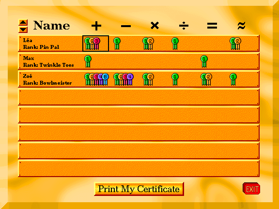
*Le Hall of Fame : huit joueurs par page, les flèches pour changer de page, et « Print My Certificate » en bas.*

- Les **flèches** en haut à gauche changent de page (huit joueurs par page).
- Cliquez sur une **case** de la grille (un joueur, un type de questions) puis sur **Print My Certificate** : un **certificat** (« Certificate of Merit »), à ce nom, avec les rubans gagnés et le rang, est **téléchargé en image PNG** (au format paysage). Aucun certificat n'est possible tant qu'aucun niveau de ce type n'est réussi.
- **Exit** revient au Bowling.

## Commandes

**Souris ou toucher** : un clic (ou un toucher) suffit pour tout.

**Déplacer une pièce** (Hidden Picture Puzzles, Puzzle Patterns, Super Sticklers, Rhythm Shop) : selon le réglage **Click & Stick Mouse** (activé par défaut), cliquer pour prendre puis cliquer pour poser, ou bien glisser sans relâcher. En mode cliquer-poser, tant qu'une pièce est en main, un clic la pose.

| Touche | Où | Effet |
|---|---|---|
| **1** à **4** | Bowling for Numbers | choisir la réponse 1 à 4 |
| **Espace** | Hidden Picture Puzzles, Puzzle Patterns, Super Sticklers | tourner la pièce (quart de tour) |
| **1** à **9** | Rhythm Shop | choisir un des neuf outils (Cutter, Gluer, Melder, de gauche à droite) |
| **Tab** | Rhythm Shop | outil suivant |
| **x** / **z** | Pattern Windows | couleur suivante / précédente |
| **Entrée** | moniteur de connexion | valider le nom, fermer (OK) |
| **Tab**, **Maj + Tab**, **Entrée** | dans le jeu | parcourir les boutons au clavier et activer celui qui est sélectionné |
| **Ctrl + clic** sur Sign-in | salle de contrôle | ouvrir les préférences |
| **Ctrl + Q** | partout | quitter le jeu |

## Sur mobile

Le jeu se joue au doigt : un toucher remplace le clic.

- **Les préférences** : faites un **appui long** (environ une demi-seconde) sur le bouton Sign-in, à la place du Ctrl + clic.
- **Les touches** (1 à 4, Espace, x / z, Tab) n'ont pas besoin de clavier : touchez directement les réponses, le bouton **Rotate**, les couleurs ou les boutons d'outils.
- **Déplacer une pièce** : touchez-la, puis touchez l'endroit où la poser (réglage d'origine). Le glisser est possible si vous désactivez Click & Stick dans les préférences.
- La saisie d'un nom fait apparaître le clavier de l'appareil.

## La version de 1994 et celle de 1997

Il existe un manuel en anglais de **Math Workshop Deluxe** (version 2.0, 1997). Cette page décrit le jeu de **1994**, qui est celui joué ici. Ce que vous lirez dans le manuel de 1997 et que **vous ne trouverez pas** ici :

- la salle de contrôle n'a **qu'un seul étage** (pas de « Level 1 / Level 2 » ni de bouton Upstairs, Downstairs) ;
- il n'y a **pas de Boiler Room** (la chaufferie et ses flammes) ;
- il n'y a que **trois boutons** sur le pupitre de Poly (Quit, Help, Sign-in) : pas de bouton Math Trivia (c'est un clic sur Poly), Preferences (c'est Ctrl + clic sur Sign-in) ni Tracking ;
- **pas de suivi de progression** ni d'export (le Hall of Fame est le seul suivi) ;
- **pas de Custom Play** ni de bouton Practice au Bowling ;
- **pas de bouton Demo** au Rhythm Shop ;
- **pas de jeu à deux** dans Hidden Picture Puzzles ;
- **pas de Parents' Video Guide** (les vidéos) ;
- les **tableaux** de Puzzle Patterns du niveau rouge sont au nombre de neuf (le manuel de 1997 n'en cite que sept dans ses indices) ;
- **Rockets** est un jeu de Nim contre Poly, qui est une personne (Poly Gonzales) et non un perroquet ; son niveau n'est ni affiché ni enregistré ;
- ici, « Print » et « Print My Certificate » **téléchargent une image** au lieu d'imprimer ;
- les **joueurs** se gardent dans le navigateur (et non dans un fichier MWRoster) ; les prénoms peuvent contenir des lettres accentuées.

## Crédits et mentions

**Math Workshop** est un jeu **Broderbund (Brøderbund Software)**, © 1994. *Math Workshop*, *Active Mind Series* et *Brøderbund* sont des marques de leurs propriétaires.

**Cette réimplémentation est un projet de fan**, sans lien avec les ayants droit : elle fait tourner le jeu dans le navigateur en lisant les fichiers de données du CD d'origine, qui ne sont pas fournis ici. Cette page n'est pas le manuel d'origine : c'est un texte réécrit, adapté à la version de 1994.

**L'équipe d'origine**, d'après la liste du manuel de 1997 (celle du CD de 1994, qui défile à l'écran Crédits, peut différer) :

- **Concept original** : Mark Schlichting. **Conception** : Amanda Crispel (direction), Bo Everson, Hilary Nation, Tom Rettig. **Production** : Hilary Nation. **Gestion de produit** : Sioban Scanlon.
- **Programmation** : Lance Groody et Frankie Ford (direction), Bob Arient, Michael G. Rivard, Diane Cerreta, Rod Nelson, avec Grace Kim, Ben Ceschi, Samir Ramji, Guy Nicholas, Jeff Charvat, Bob Gulian, Glenn Axworthy, Michael Zacks.
- **Direction artistique** : Bo Everson, Michelle Bushneff. **Personnages et animation** : David Magliocco. **Art et animation** : Brad Pollard, Michelle Graham, Avril Harrison, Stephen Peterson, Cheryl Middleman, Phillip Bossant, Bob King, Kevin Dooley, avec Julie Glavin, Caitlin Mitchell-Dayton, Peter Mitchell-Dayton, Peter Babakitis. **Infographie** : Martha Embry.
- **Direction sonore** : Tom Rettig, Jonelle Adkisson. **Conception sonore** : Michael Barrett, Chris Clanin, avec Joey Edelman, Tom Hays, John Loose, Gary Schwantes, Brian Woodbury, Jane Scolieri, Tim Larkin.
- **Voix** : Miriam Carr, Tom Rettig, Mark Schlichting, Michael Barrett, Carl Albert. **Dialogues** : Suze Allen, Jana Goerlitz, avec Valorie Singer et Sioban Scanlon.
- **Photographies** sous licence de : American Photographic Archives, Inc. ; Association des Amis de Jacques Henri Lartigue ; Rick Doyle ; Underwood Photographic Archive ; Wayzata Technology, Inc. ; The IMAGE Bank, Inc.
- **Remerciements particuliers** à Margo Nanny et Phil Gonsalves, et à tous les enseignants, parents et enfants qui ont contribué au jeu.

**Cette version du site** : la musique est jouée avec la soundfont *GeneralUser GS* (licence fournie avec le jeu), réduite aux instruments du jeu.
