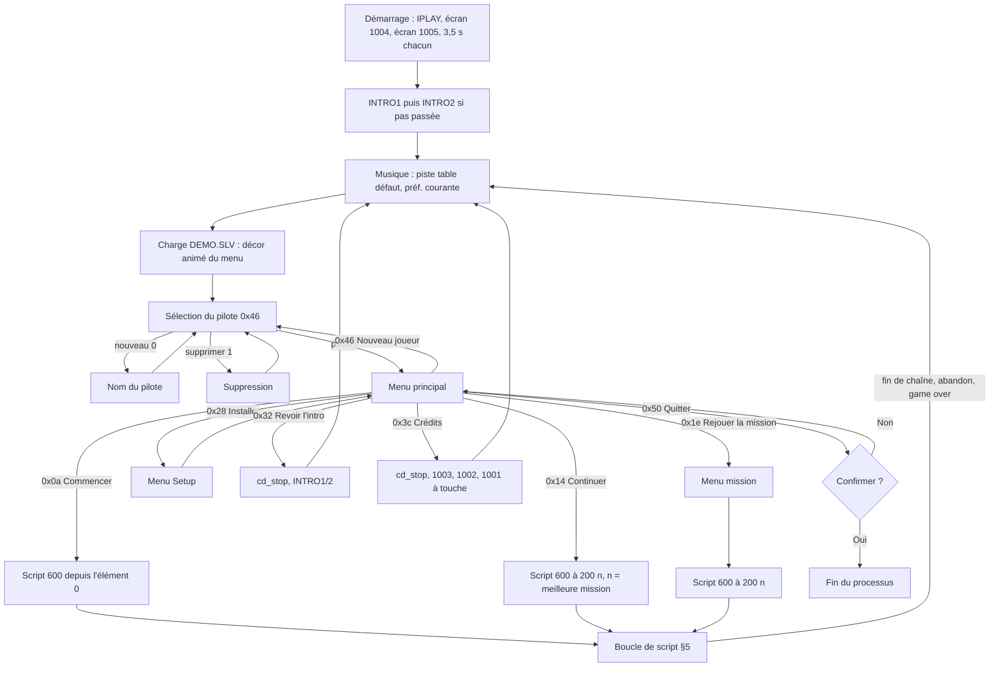

# SWIV 3D — écrans, enchaînement, pilotes, musique

Rétro-ingénierie du « front-end » de `SWIV_WIN.EXE` (rendu logiciel) : démarrage, intros, menus, exécution du script de missions (bloc 600), briefings, écrans de fin, sauvegarde des pilotes et musique. Base de la vague H3 (écrans) et G3 (musique). Sources : décompilations `archives/swiv3d/re/decomp/` et `disasm.txt` (la décompilation Watcom perd les arguments en registres : tout ce qui est donné en immédiat a été relu dans le désassemblage), `GLOBAL.BD` (chaînes, script 600, écrans 1001-1005), `ANIMS/*.SCR`, `MANUEL.TXT`. Voir `plan.md`, `re-index.md`, `global-bd.md`, `smacker.md`.

Légende : **confirmé** = lu dans le code (adresse donnée) ; **hypothèse** = déduit, non prouvé ; **ouvert** = non établi. Les adresses `00xxxxxx` sont celles de `SWIV_WIN.EXE` (base `00400000`). Les données `DAT_...` citées sont des globales du corpus, sans nom dans `keyfuncs.def.tsv`.

## 1. Vue d'ensemble

- Écran de jeu : **320×400, 8 bits indexé**, mode X « déchaîné » en 4 plans (pages `A0000`/`A8000`), comme les vidéos Smacker et les écrans 1001-1005. Toute la UI (menus, textes) est dessinée dans cette image avec la police 2D du bloc 507 et la table de mélange (bloc 800) : voir §6.
- Tous les textes viennent de `GLOBAL.BD` bloc 100 (`gm_get_string` `0046f8f4` : groupe, numéro). Le groupe est la « table » des chaînes ; les ids de chaînes ci-dessous sont ceux de `StringTables.get(langue, table, id)`.
- Le programme est une grande boucle dans `gm_main_game` (`00421614`) : démarrage → intro → boucle (menu principal → script de missions) → sortie. Les menus ne sont pas des écrans figés : le **moteur de menu** `00415a20` rappelle `gm_frame` (`0042f64c`) à chaque image, donc la scène 3D de `DEMO.SLV` anime le fond (§4.1).
- Quatre globales gouvernent le flux (toutes confirmées) : `DAT_00480a9c` (état du niveau : `1` en jeu, `0x2a` mission accomplie, `0x34` joueur mort, `2` retour aux menus, `-1` menu, `-2` quitter), `DAT_00484630` (fermeture demandée), `DAT_00480c44` (écran à jouer au prochain tour : `1` intro, `2` crédits ; vaut `1` à l'état initial dans l'exécutable), `DAT_00480aa0` (« une touche ou un bouton de souris a été pressé », posé par `gm_wndproc` sur `WM_KEYDOWN` et les clics, remis à zéro par `gm_clear_keys` `00410010`).

## 2. Séquence de démarrage

Chaîne de `gm_winmain` (`00410928`) : fenêtre « swiv_win », souris/manette, `swiv.cfg`, `GLOBAL.BD` (`gm_global_init`), `SOUNDS.BD`, CD audio (MCI), puis `gm_main_game`. Les fonctions `0046feec`, `0046ff08`, `0046ff24`, `0046ff3c` (appelées avec des codes 3000-3008) sont des **fonctions vides** dans `SWIV_WIN.EXE` (accroches de transition des versions 3Dfx/D3D) : à ignorer. Le drapeau `0x80` de `GLOBAL.BD` bloc 2 est posé (`0xb2`), donc la séquence de logos suivante s'applique (`00421614`, `004216b5-0042186c`, confirmé) :

| # | Écran | Durée / sortie | Détail |
|---|---|---|---|
| 1 | Vidéo `IPLAY` (`ANIMS/IPLAY.SMK`) | jusqu'à la fin, ou touche / clic gauche | Smacker 22 050 Hz stéréo, 491 images à 71 ms ≈ 34,9 s. La dernière image reste affichée. |
| 2 | Attente | **3 500 ms** (`gm_delay_ms(0xdac)`, boucle d'attente sans traiter les messages : non interruptible) | La dernière image de `IPLAY` reste à l'écran. |
| 3 | Écran **1004** (« an SCi game ») | **3 500 ms** | Drapeau `0x20`. Palette du bloc (via la table de gamma), plans copiés, page affichée, puis attente (`FUN_0042fddc`/`FUN_0042fd24`/`FUN_0042ff5c`). |
| 4 | Écran **1005** (titre « TEMPERATE ZONE ») | **3 500 ms** | Drapeau `0x02` (même bloc `0x3ed` que `0x01`). L'attente de 3,5 s qui suit (`0042186c`) est celle de cet écran. |
| 5 | Vidéo `INTRO1`, puis `INTRO2` si `INTRO1` n'a pas été interrompue | fin ou touche / clic | Joué parce que `DAT_00480c44 = 1` à l'état initial. `gm_play_smacker` (`0046edb8`) renvoie 1 si l'utilisateur a interrompu, 0 sinon : `INTRO2` ne se joue que si `INTRO1` s'est terminée. Après l'intro, `DAT_00480c44` repasse à 0. |
| 6 | Musique + menus | | `gm_cd_play_track(table_musique[préférence])` démarre ici : **aucune musique CD avant la fin de l'intro**. Puis chargement de `DEMO.SLV`, sélection du pilote, menu principal. |

- Le logo Windows `MYLOGO` (`gm_load_logo_resource`, `gm_paint_logo`) n'est pas un écran de démarrage : il est peint dans la fenêtre quand elle perd le focus (confirmé : `WM_PAINT` seulement si `DAT_00480ab0 == 0`).
- Les écrans 1003 (titre « SWIV 3D »), 1002 (crédits) et 1001 (mentions légales) ne sont montrés qu'à la demande par « Crédits » (§4.5). Les blocs `0x3ee`/`0x3ef` (1006, 1007) que `gm_main_game` affiche en fin de partie ne servent qu'avec le drapeau démo `0x01` (absent ici, absents de `GLOBAL.BD`).
- Aucun écran n'a de minuterie d'attente à touche : les écrans de logos ont 3,5 s fixes, les autres attendent `DAT_00480aa0` (touche ou clic).
- **Branche morte** : `DAT_00480a98` (jamais écrite, 0 dans l'exécutable) ferait jouer `DEMO.SLV` seul avec `gm_start_level` ; elle n'est pas atteinte.
- Anomalie (reliquat de développement) : `gm_main_game` appelle `fopen("g:\x07nimsintro1.scr", "r")` (chaîne `00480314`) dont le résultat est ignoré.

### Remarques pour le port navigateur
- Le navigateur interdit l'audio avant une interaction : prévoir un écran « cliquer pour commencer » devant `IPLAY` (le clic compte pour l'activation audio, pas pour « passer »).
- Garder `IPLAY`, les 3,5 s et `INTRO1/2` ; autoriser de passer les temporisations (l'original ne le permet pas, c'est un confort sans risque).

## 3. Boucle principale et diagramme

`gm_main_game` mémorise l'action du menu (`local_28`, valeurs ci-dessous) et boucle (`00421bbd`-`0042293a`).

Valeurs de retour du menu principal (confirmées, `0041d714` et `00421d12-00421ea8`) :

| Id | Libellé (table 1) | Effet dans `gm_main_game` |
|---|---|---|
| `0x0a` (10) | 10 « Commencer le jeu » | Script depuis l'élément 0. |
| `0x14` (20) | 11 « Continuer » | Saute à l'élément `200 n` où `n` = meilleure mission du pilote (`+0x20`). |
| `0x1e` (30) | 12 « Rejouer la mission » | `gm_menu_retry` (`0041dde4`) renvoie `n` ou `-1` (Esc : retour menu, `DAT_00480a9c = 2`) ; saute à `200 n`. |
| `0x23` (35) | 16 « Multi-joueur » | `gm_start_level` en réseau (`netlevNN`). Masqué : `DAT_00480b68 = 0`. Hors périmètre. |
| `0x28` (40) | 13 « Installer » (= **Setup**, en anglais « Setup ») | `gm_menu_setup`, puis le menu principal est réaffiché. |
| `0x32` (50) | 14 « Revoir l'intro » | `DAT_00480c44 = 1`, `gm_cd_stop`, intro, retour. |
| `0x3c` (60) | 15 « Crédits » | `DAT_00480c44 = 2`, `gm_cd_stop`, 1003 → 1002 → 1001, une touche entre chaque. |
| `0x46` (70) | 18 « Nouveau joueur » | Retour à la sélection de pilote. |
| `0x50` (80) | 19 « Quitter » | `0041fc20` (confirmation) ; « Oui » → `DAT_00480a9c = -2` : sortie. |
| `0x5a` (90) | 20 « Entrez le mode test niveau » | Menu de mission de test `0041e614` (mode triche, `DAT_005b03fc = 1`). Visible seulement si `+0x28` du pilote > 0 (§7). |

Libellés du menu principal selon l'état du pilote (confirmé, `0041d920-0041dbbb`) : « Commencer le jeu » seul si `+0x20 == 0` ; sinon « Continuer » (sauf si `+0x20 == 0xb4c69`, aventure terminée, ou drapeau démo) et « Rejouer la mission ». Dans cette édition, ni « Multi-joueur » ni « Entrez le mode test… » ne sont visibles par défaut.

## 4. Menus

### 4.1 Moteur de menu générique (`00415a20`)

Tous les menus partagent un moteur : on remplit un tableau de lignes de 0x60 octets (`00492c30`, compteur `00493ae8`), on lance `00415a20`, qui renvoie l'**id** de la ligne choisie ou `-1`. Confirmé.

- **Lignes** (champs `[0]` id/hauteur, `[1]` couleur, `[2]` type, `[3]` pointeur, texte à `00492be0 + i·0x60`) : `FUN_004158e8` ajoute une ou plusieurs lignes à partir d'une chaîne (`|` = saut de ligne : une ligne par segment) et retient la largeur maximale (`00493af0`). Types : `0` choix, `1` bandeau de titre (id `-1`), `2` ligne de texte non sélectionnable, `3` espaceur de hauteur `[0]` px rempli avec la ligne de mélange `[1]`, `4` curseur 0..255, `5` curseur à 4 crans (`0x0f`, `0x5a`, `0xa5`, `0xf0`).
- **Mise en page** (confirmé) : centre horizontal = `DAT_00480bf8` (**160**), demi-largeur du cadre = largeur du texte le plus large / 2 + 5 ; première ligne à l'ordonnée `Y` passée à l'appel ; chaque ligne de texte fait **19 px** (`0x13`). Le texte est centré (alignement 0) à `(160, y)`. Le haut des glyphes est à `y + 4`. Un menu typique : espaceur 3 px (ligne `0xa1`), trait de 1 px (ligne `0xff`), titre(s), trait, espaceur, choix, espaceur, trait, espaceur.
- **Couleurs** (rendu par `FUN_004360b0`, remplissage d'un rectangle par une ligne de la table de mélange 800) : fond d'un choix non sélectionné = ligne `0xa1` (voile) ; bandeaux de titre = ligne `0x76` (voile) ; choix sélectionné = ligne `3` (couleur unie `0x12`) puis ligne `10` deux fois (couleur unie `0x4b`, gris clair avec la palette des vidéos), plus des liserés d'une ligne ; trait de séparation = ligne `0xff` (couleur unie `0x1a`, blanc). Les teintes réelles dépendent de la palette courante (celle de `DEMO.SLV` pendant les menus).
- **Curseur de type 4** (confirmé) : piste de 80 px (`x−40..x+40`, lignes `y+9..y+13`, ligne `0xff`), poignée à `x + valeur/4 − 32`, sur `y+5..y+18`.
- **Navigation** (confirmé, scan-codes de la file `00490410`, remplie par `WM_KEYDOWN` y compris la répétition automatique) :

| Touche | Scan-code | Effet |
|---|---|---|
| Haut / Bas (et pavé étendu) | `0x48`/`0xc8`, `0x50`/`0xd0` | Ligne précédente / suivante parmi les types 0, 4, 5, **avec bouclage** ; son 6002. |
| Entrée, Entrée du pavé | `0x1c`, `0x9c` (et bouton `0xf0` de la manette) | Valide : renvoie l'id ; son 6003. Ignorée pendant les 3 premières images du menu. |
| Échap, F1 | `0x01`, `0x3b` | Annule : renvoie `-1`, sauf si le drapeau `0x20` est posé (menu principal, sélection de pilote : pas d'annulation) ; son 6003. |
| Gauche / Droite (maintenues) | `0x4b`/`0x4d` (+ étendus) | Curseur type 4 : `± 2 × DAT_00480bf0` par image (butées 0 et 255) ; type 5 : `∓ 0x4b` (butées `0x0f`, `0xf0`). Son 6004 ; avec le drapeau `0x40` le menu rend la main après chaque changement (volumes). |
| Clic de souris | non géré | Le menu n'utilise que le clavier et la manette. |

- **Drapeaux d'appel** (registre EBX) : `0x01` sélection initiale valide (id donné par `00416834`, sinon première ligne sélectionnable) ; `0x02` ne rend pas la main avant une touche (retourne `-1` après une image : sert aux écrans d'attente) ; `0x20` pas d'annulation ; `0x40` retour après chaque réglage de curseur.
- **Sons** (SOUNDS.BD, numéro de son = id/100 ; `gm_sound_play` `00412e44`) : `6000` ouverture de pause / test, `6002` déplacement, `6003` validation ou annulation, `6004` curseur. `6001` non utilisé par les menus. Les 5 entrées existent (`600002`, `600102`, `600204`, `600304`, `600405`).
- **Titre 3D** (porté : `render/text3d/titles.ts`, tracé avec la table de couleurs du niveau de fond) : chaque menu crée un texte flottant en police vectorielle du bloc 200 (`FUN_00422f8c(groupe, id)` avec `kind = 0xb`) qui vole vers sa position en 30 images et repart à la fermeture (`FUN_004235d8`). Le titre est la chaîne `(groupe, 0)`. Position, vitesse et échelle : champs établis dans `00422f8c` (hypothèse sur leur sens exact), à porter avec le rendu de la police vectorielle déjà décodée.
- **Fond** : pendant les menus, `gm_frame` rend les vues actives du niveau chargé, soit `DEMO.SLV` (chargé avant la boucle de menu, `00421c0e`, confirmé). Pas de minuterie d'attract-mode : le « mode démo » de l'énoncé est ce décor. Le comportement exact du décor (caméra automatique ? ennemis animés ?) : **ouvert**, relève de R1/R2.

### 4.2 Sélection du pilote (`0041cfac`) et nom du pilote

- Affichée à chaque lancement après l'intro et chaque fois que « Nouveau joueur » est choisi. Titre 3D `(0, 0)` « Sélectionnez un pilote » ; bandeau `(0, 1)` ; `Y = 110`, drapeaux `0x25` (pas d'annulation). Lignes : « Nouveau pilote » (id `0`, si moins de 10 pilotes), « Supprimer le pilote » (id `1`, si au moins un), puis les pilotes (id `100 + i`, nom lu dans la fiche, **10 pilotes au plus**, numéros 0..9), complétées de lignes vides jusqu'à 9 lignes. Confirmé.
- Après le choix : `DAT_005b0410` = numéro du pilote, `DAT_005af3bc` = sa fiche (§7), `DAT_00484644` (gamma) ← `+0x30` et palette réappliquée (`0042fe44`), `DAT_00484638` (langue) ← `+0x1c`.
- **Nouveau pilote** (`0041c640`, confirmé) : titre `(0, 0x32)`, bandeau `(0, 0x33)`, texte `(0, 0x34)` = `[%s_]` avec le nom saisi. Saisie au clavier : scan-code → caractère par la table `1001` (id 0 normal, id 1 avec Maj ; `_` = touche ignorée, voir les chaînes FR/EN), **15 caractères au plus**, Retour arrière `0x0e`, Entrée `0x1c` valide si le nom n'est pas vide, Échap `0x01` annule. La fiche prend la première case libre ; sa langue est copiée de la fiche globale. **Code** : un nom égal à `SWIV!AndLetDie` (`00480234`) n'est pas créé : il pose `+0x28 = 1` sur la fiche de travail (déverrouille « Entrez le mode test niveau » et les commandes de débogage) et la saisie recommence (hypothèse très probable, comparaison faite par `00470ac0`).
- **Supprimer** (`0041cc78`, confirmé) : titre `(0, 60)` « Supprimer le pilote », bandeau `(0, 61)`, liste des pilotes, `Y = 110`, drapeaux `5` (Échap permis). Choisir un pilote l'efface **sans confirmation** : `FUN_0046eb98(0x14, p, -1)` libère toutes les cases de clé `(0x14, p, *)` (fiche, contrôleurs, états de mission). Les chaînes `0/100` « Oui » et `0/101` « Non » ne servent pas ici (elles servent à l'option « Fog »).

### 4.3 Menu Setup (`0041b03c`, groupe 2)

Titre `(2, 0)` « Installer » (**c'est « Setup »** : la chaîne française est un faux ami), `Y = 160`, drapeau `0x01`. Lignes (ids de retour = id de chaîne, confirmé) :

| Id | Chaîne FR / EN | Action | Pertinence navigateur |
|---|---|---|---|
| 10 | Installation du contrôleur / Controller Setup | `00418454` (§4.4) | Remplacer par une config clavier/manette. |
| 11 | Volume / Sound Volume | `gm_menu_volume` (§4.6) | Oui (3 curseurs). |
| 12 | Choix de la langue / Language Setup | `004191ac` : liste les langues (table commune 0), départ sur la langue courante, `Y = 140` ; choisir écrit `DAT_00484638` et `+0x1c` | Oui, FR et EN seulement. |
| 13 | Correction gamma / Gamma Correction | `gm_menu_gamma` (§4.6) ; **mode logiciel seulement** (`DAT_0048464c == 0`) | Oui. |
| 14 | Choix des musiques / Music Preference | `gm_menu_music` (§4.7) ; la préférence est recopiée dans la fiche (`+0x24`) | Oui. |
| 15 | Commandes de débogage [%s] | seulement si `+0x28 > 0`, bascule `DAT_00480bdc` | Non. |
| 16 / 17 | Taille de l'écran / Screen Size : curseur type 4 sur `DAT_00480c88` (défaut 255) | si `DAT_00484624 == 0` (pas de MMX : `DAT_00484624` = le processeur a MMX, posé par `gm_detect_mmx`) | Optionnel (agrandir/rétrécir la fenêtre de rendu ; touches `-`/`+` du pavé en jeu : ±5). |
| 17 / 18 | Résolution / Detail Level : curseur type 5 sur `DAT_00480c64` (4 crans, défaut `0xf0`) | si `DAT_00484624 == 0` | Optionnel (détail du rendu, relève de R4). |
| 19 | Fog [Oui/Non] | **mode 3Dfx** (`DAT_0048464c == 1`) | Non. |

À la sortie : `fiche globale (0x0a, 0x7d0, -1) +0x14 = DAT_00480c58` (brouillard, 1 par défaut). Le menu se réaffiche jusqu'à Échap (le code sort aussi sur l'id 17, le curseur d'écran).

### 4.4 Contrôleurs (`00418454`, `004171b4`, `0041797c`, `004168b0`, `00416b50`)

- Fiche (0x14, pilote, 2) : `+0x0c` = type de contrôleur (`0` non configuré, `1` clavier, `2` souris, `3` manette, `4` Gravis, `5` DirectInput, `6` Creative : chaînes `3/11..16`). À chaque tour du menu principal `00418f54` rouvre le menu si le périphérique a disparu (`+0x0c` ramené à 0). Premier lancement d'un pilote : le menu de choix du type s'ouvre automatiquement.
- Les liaisons sont affichées `« Tourner ← [touche] »` (chaînes `3/21..32`), le nom de la touche vient de la table `1000` (noms par scan-code : « Tab », « Ctrl à gauche »…), la capture d'une touche (`004168b0`, chaînes `3/33`, `3/34`) puis l'affectation d'axes (`1000`, `1001`, `1010..1013`) et les calibrages (`3/330..343`).
- Défauts du manuel : flèches (tourner/avancer), `<` `>` et Ctrl (déplacement latéral), Espace (tir principal), `M` (tir spécial), Pg. Suiv./Pg. Préc. (sélection), `1`-`9` (armes spéciales), Pause, Échap (abandonner). Le détail des octets de la fiche (axes `+0x3c..0x3f`, 6 touches `+0x40..0x54`) est **partiel** ; la table exacte des touches est du ressort de R1 (`player.md`).
- Port : Types DirectInput/Gravis/Creative sans objet ; garder un écran de redéfinition des touches et la détection de la manette (Gamepad API).

### 4.5 Crédits et intro

« Revoir l'intro » et « Crédits » arrêtent le CD (`gm_cd_stop`), jouent leur contenu, relancent la musique en haut de boucle. « Crédits » : 1003, attendre `DAT_00480aa0`, 1002, attendre, 1001, attendre. Chaque écran : `FUN_0042fddc` (efface et charge la palette 6 bits via la table de gamma), `FUN_0042fd24` (copie les plans `+0x2300`), `FUN_0042ff5c` (bascule de page). Confirmé (`00421a2d`-`00421ba4`).

### 4.6 Volume et gamma

- **Volume** (`0041a8c4`, groupe 8, `Y = 160`, drapeaux `0x41`) : trois curseurs 0..255, ids 1/2/3, branchés sur le **mélangeur Windows** (`gm_mixer_*`) : « Volume principal » (`DAT_00484614`), « Volume du CD » (`DAT_00484610`), « Volume des effets son » (`DAT_00484618`). Si le périphérique n'existe pas (valeur `-1`), la ligne devient « <<Impos. régler vol.>> » (`8/6`). Le réglage est appliqué à chaque changement (`gm_mixer_set_volume`, `004121dc`). **Non sauvé par le jeu** (c'est le mélangeur qui le garde) : le port le stocke dans `SoundPrefs` (voir `plan.md`) ; musique = volume du CD, effets = `SOUNDS.BD`.
- **Gamma** (`00417ffc`, groupe 6, `Y = 160`) : 4 choix (ids 0..3 : aucune, faible, moyenne, haute). Choisir : `DAT_00484644` et fiche `+0x30` = valeur, palette réémise. Le menu reste ouvert jusqu'à Échap. **Table de gamma** (`0042469c`, confirmé) : sur les composantes 6 bits `i` de 0 à 63, valeur = `63 · (i/63)^(1 − 0,125 · g)`, `g = 0` identité. Elle est appliquée à chaque chargement de palette (`FUN_0042fddc`).

### 4.7 Musique (`0041a560`, groupe 9)

Titre `(9, 0)` « Musique » ; trois choix : `10` « SWIV » (0), `11` « Classique » (1), `12` « Divers » (2), la liste s'arrêtant sur la chaîne `13` = `#`. Choisir : `DAT_00484634 = n` et la piste `table[n]` démarre tout de suite (§8). Confirmé.

### 4.8 Pause, abandon, quitter

- **Pause** (`gm_screen_pause` `00419058`) : touche `DAT_00480a94` = scan-code **`0x45`** (Pause) en jeu ; son 6000. Titre 3D `(4, 0)` « Pause », ligne `(4, 1)` « N'importe quelle touche pour continuer » (id 99), `Y = 260`, drapeaux `3`, boucle jusqu'à `DAT_00480aa0`. Confirmé. Le monde est **figé mais dessiné** derrière (le menu rappelle `gm_frame`, sans radar ni HUD) ; port : `ui/level-session.ts` saute l'horloge et les ticks, rend la vue et le HUD en mode pause, le titre « Pause » est un texte 3D (type 11) et n'importe quelle touche, Échap compris, ou un appui sur l'écran reprend.
- **Abandon** (`gm_menu_abort` `0041f8e8`, groupe 13) : déclenché en jeu par Échap (`DAT_00490014`). Titre `(13, 0)` « Abandonner la mission », ligne `(13, 1)` « Voulez-vous abandonner la mission en cours ? », choix Oui (`13/10`, renvoie 1) et Non (`13/11`, renvoie 2), `Y = 160`, drapeau `1`. « Oui » : ajoute le temps joué à la fiche et `DAT_00480a9c = 2` (retour menu principal, **sans écran de score ni sauvegarde de l'état**).
- **Quitter** (`0041fc20`, groupe 13) : titre `(13, 0x14)` « Quitter Swiv », ligne `(13, 30 + (DAT_00480bec & 3))` : une des 4 phrases `13/30..33` (« Voulez-vous vraiment abandonner ? », « Vous êtes une vraie poule mouillée ! », « Préférez-vous vraiment le système d'exploitation ? », « Allez-y, vous ne perdez rien pour attendre ! »), compteur `DAT_00480bec` incrémenté à chaque affichage ; Oui (renvoie 1) / Non, drapeaux `5`. Port : « Oui » ramène à la page d'accueil du site.

## 5. Exécution du script de missions (bloc 600)

`gm_main_game` (`00421a..00422937`) parcourt `DAT_005bc168` (les éléments de 16 octets, voir `global-bd.md`). Confirmé, sauf mention.

### 5.1 Boucle

1. Le point d'entrée dépend du menu : élément 0 (Commencer), `200 n` avec `n = fiche +0x20` (Continuer), `200 n` choisi (Rejouer ; `DAT_005b03fc = 0`), `200 n` du menu de test (`DAT_005b03fc = 1`).
2. Avant la boucle : `FUN_0046ea00` met à zéro la **structure d'état de mission** (28 dwords) de travail.
3. Tant que `DAT_00480a9c ∉ {-2, 0x34, 2}` et que l'étiquette n'est pas `-1` : exécuter l'élément puis passer au suivant. Les missions s'enchaînent donc **sans retour au menu** tant que le joueur réussit (un « Rejouer la mission 1 » joue 1, 2 puis 3).
4. À la fin du script, ou si le joueur meurt (`0x34`) ou abandonne (`2`) : `local_28 = -1`, table musicale remise à `{2, 9, 3, 2, 2, 2}`, retour en haut de la boucle principale (musique du menu, `DEMO.SLV`, menu principal). **Il n'y a pas de rejeu automatique** après un game over.

### 5.2 Éléments

| Étiquette | Comportement exact |
|---|---|
| `100`/`101`/`102`/`103` `(variable, valeur)` | affecte / maximum / minimum / ajoute sur la structure d'état (tableau §5.3). |
| `200 n` | mission `n` : `DAT_00480c4c = n` (sert aux textes `.SCR` de table 200 et aux écrans de fin) ; si pas en mode test et `fiche +0x20 < n` : `+0x20 = n` (la meilleure mission est celle **démarrée**, pas terminée). Si la mission précédente s'est terminée par `0x2a` (hors test) : l'état fin de niveau du joueur (structure `local_158`, remplie par `FUN_0043cd14`) est **recopié dans la fiche (0x14, pilote, 1000 + n)**. Puis `DAT_004841c0 = local_158` et, hors test, l'état de la mission est chargé depuis cette fiche ; en test il est mis à zéro avec `+0x3c = 400`. Effet : « Rejouer la mission n » repart de l'état d'armes de l'arrivée dans n. |
| `300` + nom | `gm_slv_load("%s.slv")`. Si le chargement échoue : `DAT_00480a9c = 2` (retour menu). Sinon : recopie la configuration des contrôleurs de la fiche (0x14, p, 2) dans les globales du jeu (`004841a4`, `00484188/8c/90`, `005b043c`, `005b0418..2c` : type, axes, touches), `FUN_00454cb0` (initialisation du niveau), `DAT_00480a9c = 1`, `gm_cd_play_track(table[préférence])`, `DAT_005b0404 = 0` (compteur de temps), puis la boucle de jeu. **Aucun écran de « début de mission »** : le niveau démarre aussitôt après la vidéo de briefing. |
| `400` + 6 u16 | `table_musique[0..5] = u16` (§8). |
| `500` + nom | `gm_cd_stop`, vide les touches, `gm_play_smacker(nom)` (vidéo + `.SCR` si le nom commence par `BR_TER`). |
| `600 (r,g,b)` | `00484650 = (r·256 + g)·256 + b` ; sans effet visible dans les écrans ; probablement couleur d'ambiance du rendu (R4). |
| `-2` | fiche `+0x20 = 0xb4c69` : aventure terminée. |
| `-1` | fin du script. |

Boucle de jeu (confirmé, `0042215a`-`004222a5`) : `DAT_00480a9c = 1` ; chaque tour : si Échap (`DAT_00490014`) → `gm_menu_abort` ; `gm_frame` ; `gm_poll_events`. À la sortie : si `0x34` → temps joué ajouté à la fiche (`+0x2c += DAT_005b0404 / 40`, **40 ticks/s**, hypothèse sur l'unité) puis `FUN_00419ed8` (écran **Game over**) ; si `0x2a` → idem puis `gm_screen_level_complete` (écran **Mission accomplie**) et `FUN_0043cd14` (copie l'état du joueur : 20 munitions u16, énergie, arme primaire, véhicule). Dans tous les cas : `gm_sound_stop_all`, **`gm_cd_stop`**, remise à zéro des globales du joueur, **`gm_cfg_save` : `swiv.cfg` est écrit après chaque niveau** réellement chargé : réussi, perdu ou abandonné par Échap. Un abandon ne produit ni écran de score ni état d'armes pour la mission suivante.

Le jeu « cut-down » enchaîne `TERRAN00` → `TERRAN03` : après la mission 3, l'élément `200 999` (rien à jouer : aucun fichier) puis `-2` termine l'aventure, `-1` rend la main : le menu principal réapparaît sans « Continuer », avec « Rejouer la mission » ouvert aux 4 missions (la table 200 des noms s'arrête à `4 = "#"` : le menu ne propose que 4 missions, même terminé).

### 5.3 Variables (sens déduit)

La structure d'état de mission (28 dwords à `+0x0c` de la fiche) contient les 20 munitions d'armes spéciales (u16 à `+0x0c + 2k`), puis `+0x34`, `+0x38`, `+0x3c`, `+0x40`.

| Variable | Cible | Valeurs du script | Sens |
|---|---|---|---|
| 0 | `+0x38` ← joueur `+0xa4` | 0, 1, 2, 3 | **Véhicule de départ** (hypothèse forte : noms `100/200..203` « Héli. », « Buggy », « Skidoo », « Hoovercraft » ; 0 à la mission 0, 1 aux missions 2-3, 2 à l'Arctique, 3 sur Mars). |
| 1 | `+0x3c` ← joueur `+8` | 496 (mission 0), `max(…, 248)` ensuite | **Énergie** (hypothèse : 248 = 100 %, 496 = 200 % de « méga-énergie », selon le manuel). |
| 2 | `+0x34` ← joueur `+0x108` | 0 (mission 0) | Niveau d'arme principale (hypothèse). |
| 3 | `DAT_00577670` | 3 (défaut, remis à 3 avant le menu), 1 (boss), 0 (Lune, Mars) | Si ≠ 0 et détail maximal, `gm_frame` dessine un élément (`FUN_00437b64`) : **ouvert** (R3/R4). |
| 4 | `DAT_004841b0` | 0 (Terran), 1 (Arctique), 2 (Lune), 3 (Mars) | **Zone / décor** (hypothèse forte : corrélée au nom de niveau). |
| `100 + k` (k de 0 à 19) | munition de l'arme spéciale `k` | `109` et `119` mises à 0 à chaque mission | Formule vérifiée : l'adresse est `2·var − 0xbc` = `+0x0c + 2·(var − 100)`. Les icônes du bloc 501 (20 armes) et les noms de la table `100/0..19` (« Missiles », « Missiles Autolock »… « Accélérateur ») indexent ces 20 emplacements. |

### 5.4 Chaîne livrée

| n | Nom FR / EN | Niveau | Vidéo | Pistes (SWIV / Classique / Divers) | Couleur |
|---|---|---|---|---|---|
| 0 | Fastoche / Rookie | `TERRAN00` | `BR_TER0` (avant la piste) | 3 / 9 / 2 | (100,100,120) |
| 1 | Chercher et Détruire / Seek & Destroy | `TERRAN01` | `BR_TER1` | 4 / 10 / 10 | idem |
| 2 | L'Estuaire Sanglant / Estuary Assault | `TERRAN02` | `BR_TER2` | 5 / 9 / 6 | idem |
| 3 | Montagnes Russes / Breakout! | `TERRAN03` | `BR_TER3` | 6 / 9 / 3 | idem |

Ordre dans chaque mission : variables, puis (`500` vidéo et `400` pistes dans l'un ou l'autre ordre, sans conséquence car la piste ne démarre qu'à l'élément `300`), `600`, `300`. Missions 4 à 16 (`TERRAN04..BS`, `ARCTIC`, `LUNAR`, `MARS`, `END_*`, `OUTRO`) : hors périmètre, sans fichiers.

## 6. Briefings : vidéo Smacker + texte `.SCR`

- **Déclenchement** (`gm_play_smacker` `0046edb8`, confirmé) : le nom est `BR_TERn` ; `.SMK` ouvert par `SmackOpen` (refus si plus de 320×400) ; si le nom commence par `BR_TER`, `gm_load_scr` lit `BR_TERn.SCR`. `DAT_005bc180` est ramené à la table de mélange **globale** (bloc 800 de `GLOBAL.BD`), pas celle du niveau.
- **Cadence** : `SmackWait` (71,4 ms par image, ≈ 14 images/s), son DirectSound. Touche ou clic gauche (`WM_KEYDOWN`, `WM_LBUTTONDOWN`) : interrompt (retour 1).
- **Affichage image par image** (`00437eac`) : attente de retour vertical, copie de l'image décodée vers la page, **puis tracé des textes du `.SCR` pour l'image courante** (numérotée **à partir de 1**), puis bascule de page. Les textes sont donc redessinés à chaque image sur une image neuve.
- **Format du `.SCR`** (`gm_load_scr` `0046ec40`, `fscanf("%d %d %d %d %d %d %s %s")`, confirmé) : une ligne = `table id première dernière x y style alignement`.

| Champ | Sens | Exemple (`BR_TER0`) |
|---|---|---|
| 1 `table` | groupe de chaînes | `200` (noms de missions), `22` (repères de carte), `20` (objectifs) |
| 2 `id` | numéro de chaîne ; **si la table vaut 200, il est remplacé par la mission courante** (`DAT_00480c4c`) | `0` → « Fastoche » |
| 3, 4 | première et dernière image où le texte est visible (inclus) | `108 367` |
| 5, 6 | `x`, `y` (voir alignement) | `295 370` |
| 7 style | `b` → style 1 (**blanc**), toute autre lettre (`g`) → style 0 (**gris**) | `g` |
| 8 alignement | `l` gauche (x = bord gauche), `c` centré, toute autre lettre (`r`) droite (x = bord droit) | `r` |

Les 4 briefings livrés (textes FR / EN, vérifiés) : `BR_TER0` « Fastoche » en gris, à droite à (295, 370), images 108-367 ; « Nord » (24, 9) 270-367 ; « Guide des objectifs » (71, 80) 320-367 ; « Commencer » (200, 330) 108-367 ; « Objectif 1 » (202, 192) 158-367 ; « Objectif final » (54, 180) 208-367. `BR_TER1/2/3` : nom de la mission en gris à gauche en (10, 10) dès l'image 5 ; « Commencer », « Objectif 1.. », « Objectif final » en blanc à gauche, apparaissant à tour de rôle (50 images environ entre chaque), jusqu'à la dernière image utile (313, 306, 258). Table 20 : `20/9` → « Objectif 1 », `20/8` → 2, `20/7` → 3. `scr.ts` expose ces six entiers en champs neutres : on peut les nommer `{table, id, firstFrame, lastFrame, x, y}` et `{style, align}`.

- **Rendu des textes** (confirmé) : police 2D du bloc 507, une chaîne est coupée à **280 px** de large (`0x118`, la chaîne est tronquée par un NUL) ; avance par glyphe = bloc 508 ; `gm_draw_label` (`00437d68`) choisit le tracé selon le style. Un glyphe est un sprite RLE à 4 plans : ses pixels sont des **numéros de ligne** `banque + teinte` de la table de mélange (800), la couleur écrite est `table[ligne << 8 | pixel déjà présent]`.
  - style **`b`** (`gm_draw_string_a` → `gm_blit_rle_glyph_a` `0041508b`) : ligne = `banque + teinte` ;
  - style **`g`** (`gm_draw_string_b` → `FUN_00415126`) : ligne = `banque + (teinte >> 1)` : teinte divisée par deux, donc plus sombre ;
  - la face du glyphe (teinte `0xf`, banque 0) vaut la couleur `0xa3` en style `b` et `0x3f` en style `g` (lignes `0x0f` et `0x07` de la table 800 : couleurs unies). Avec la palette des vidéos de briefing (identique sur `BR_TER0` et `BR_TER3`), `0xa3` = (239, 239, 239) et `0x3f` = (121, 121, 113), les ombres vont de `0xd6` (97, 105, 105) à `0x4b`/`0x5e`/`0xdc`/`0xde` : **texte blanc ombré** pour `b`, **gris** pour `g`, avec les arêtes dégradées de la police. Les autres teintes sont des lignes de fondu (`0x1x`..`0xex`) donnant les bords lissés.
  - Le haut des glyphes est à `y + 4`, 13 px de haut ; l'ordonnée du `.SCR` est le point de dessin, pas le sommet.
- Écarts navigateur : décoder les vidéos avec `src/data/smacker.ts` (déjà validé), peindre le texte en même temps que l'image dans le canevas indexé, comparer à la palette de l'image pour les couleurs 0xa3/0x3f si on veut un rendu RGB direct.

## 7. Sauvegarde : `swiv.cfg`

- **Fichier** : `swiv.cfg` (`swivdemo.cfg` avec le drapeau démo), dossier courant ; `gm_cfg_load` (`0046e740`) tente aussi `C:\swiv.cfg` (reliquat, confirmé). **Format** : suite d'enregistrements de **0x80 octets**, au plus 300 en mémoire (`005b20a0`), terminée par un enregistrement dont le premier dword vaut `0xffffffff` ; `gm_cfg_save` (`0046e8e4`) écrit toutes les cases dont la clé n'est pas `-1` puis le marqueur ; `gm_cfg_load` lit jusqu'au marqueur (confirmé).
- **Enregistrement** : 3 dwords de clé `(a, b, c)` (cases libres : `-1,-1,-1`), 28 dwords de données (`+0x0c`..`+0x7b`), un dword final nul. `gm_profile_record(a, b, c)` (`0046ea44`) retrouve ou crée la case de clé donnée.

| Clé | Rôle | Champs établis |
|---|---|---|
| `(0x0a, 0x7d0, -1)` | réglages globaux | `+0x10` langue par défaut des nouveaux pilotes (hypothèse) ; `+0x14` brouillard (3Dfx) |
| `(0x0a, 0x3f6, -1)` | dossier des vidéos (lu par `gm_play_smacker` via `0046eb5c`) | chemin de la source des `.SMK` (CD ou disque) : hypothèse |
| `(0x14, p, 1)` | **fiche du pilote p** (p de 0 à 9) | `+0x0c` nom (16 octets, NUL ; non nul = case occupée) ; `+0x1c` langue ; `+0x20` meilleure mission atteinte (`0xb4c69` = terminée) ; `+0x24` préférence musicale (0..2) ; `+0x28` mode test débloqué ; `+0x2c` temps de jeu total en secondes ; `+0x30` gamma (0..3). `+0x34`..`+0x7b` : **inutilisés** (jamais lus ni écrits ; le groupe de chaînes `10` « Meilleurs scores » n'a pas d'écran atteignable). |
| `(0x14, p, 2)` | **contrôleurs du pilote** | `+0x0c` type ; octets `+0x3c`..`+0x3f` (axes) ; dwords `+0x40`..`+0x54` (touches) |
| `(0x14, p, 1000 + n)` | **état d'arrivée dans la mission n** | 20 munitions (u16), `+0x34` arme primaire, `+0x38` véhicule, `+0x3c` énergie, `+0x40` (joueur `+0x9c` : non élucidé) |

- **Ce qui persiste d'une session à l'autre** : les pilotes (nom, langue, gamma, musique, meilleure mission, temps) ; leurs contrôleurs ; l'état d'armes d'arrivée de chaque mission jouée. **Ne persiste pas** : volumes (mélangeur), curseurs d'écran/détail, pilote choisi (on repasse par la sélection à chaque lancement), scores (non conservés).
- **Port** : `localStorage` préfixé `swiv3d:` (`prefixedStorage`), un objet JSON par pilote (`swiv3d:pilot:
` : fiche, contrôleurs, états `1000 + n`), plus `swiv3d:global`. 10 pilotes au plus, nom de 15 caractères au plus (alphabet de la table `1001`). Écrire à la fin de chaque niveau comme l'original, et à chaque changement de réglage.

## 8. Musique

### 8.1 Mécanisme (confirmé)

- Lecture par **MCI** (`gm_cd_open` `00411570`, `gm_cd_play_track` `004115bc`, `gm_cd_stop` `0041168c`) : « play cdaudio from N to N+1 notify » (piste seule) ou « from N notify » pour la dernière. Fin de piste : `gm_wndproc` (`004102a0`) reçoit la notification MCI et **relance la piste courante** (`table[DAT_00484634]`) : chaque piste **boucle**. Le drapeau `0x40` du bloc 2 forcerait la piste 2 (absent ici).
- L'unique table de lecture est `005bba10` : **6 entiers, indexés par la préférence musicale** `DAT_00484634` (0 SWIV, 1 Classique, 2 Divers), pas par contexte. Les 3 dernières entrées ne servent jamais (le script les met à 0). Valeur par défaut `{2, 9, 3, 2, 2, 2}`, **réinitialisée** à chaque retour en haut de la boucle principale (`00421bc5`, `004212..`) ; l'élément `400` d'une mission la remplace pour la durée de la mission.
- Quand elle joue : au démarrage du menu (après l'intro), à chaque changement de préférence dans le menu Musique (immédiat) ou de pilote, au début de chaque niveau (élément `300`, après le chargement). Elle est **coupée** par `gm_cd_stop` : sur « Revoir l'intro » / « Crédits » (silence jusqu'au retour au menu), sur chaque vidéo `500` (silence pendant le briefing), et à la fin d'un niveau **après** l'écran « Mission accomplie / Game over » (la musique continue donc sous cet écran).
- La préférence du pilote (`+0x24`) est lue à la sélection du pilote ; changer de pilote relance la piste si elle diffère.

### 8.2 Table de correspondance → `original/swiv3d/MUSIC/TRACKnn.MP3`

La piste n du CD est le fichier `TRACKnn.MP3` (piste 1 = données du jeu, absente). Titres d'après `MANUEL.TXT`.

| Contexte | SWIV (0) | Classique (1) | Divers (2) |
|---|---|---|---|
| Menus, pilotes, setup, retour de mission (table par défaut) | `TRACK02` | `TRACK09` | `TRACK03` |
| `TERRAN00` « Fastoche » | `TRACK03` | `TRACK09` | `TRACK02` |
| `TERRAN01` « Chercher et Détruire » | `TRACK04` | `TRACK10` | `TRACK10` |
| `TERRAN02` « L'Estuaire Sanglant » | `TRACK05` | `TRACK09` | `TRACK06` |
| `TERRAN03` « Montagnes Russes » | `TRACK06` | `TRACK09` | `TRACK03` |

| Piste | Titre (manuel) | Auteur | Durée |
|---|---|---|---|
| 2 | Night Flight Thru Babylon (thème de SWIV) | Hallucinogen | 7:13 |
| 3 | Snakey Shaker | Hallucinogen | 6:45 |
| 4 | Heroes & Hell | Louie Nicastro | 4:59 |
| 5 | Aural Onslaught | Louie Nicastro | 5:02 |
| 6 | Destroy | Paul Zimmer | 4:33 |
| 7 | Slow & Sacrificial | Louie Nicastro | 4:54 |
| 8 | Rush Induction | Louie Nicastro | 4:58 |
| 9 | Night on the Bare Mountain | Mussorgsky | 10:44 |
| 10 | Ride of the Valkyries | Wagner | 4:56 |

Les pistes 7 et 8 (missions 4 et suivantes) sont livrées en MP3 mais inutilisées par la chaîne des 4 missions. Port : `TrackPlayer` en boucle, volume = « Volume du CD » ; démarrer au chargement du niveau, couper à chaque vidéo/écran de crédits ; conserver la table « par défaut / par mission » telle quelle (indexée par préférence).

## 9. Écrans de fin de mission

Les deux écrans réutilisent le moteur de menu (drapeaux `7`, `Y = 120`, confirmé) ; le monde est toujours rendu derrière.

- **Mission accomplie** (`gm_screen_level_complete` `004194b0`) : titre 3D `(7, 0)` « Mission accomplie ! » ; bandeau = nom de la mission (table 200, mission courante) ; lignes (groupe 7, `sprintf`) : `10` « Score : %d » (niveau), `11` « Score : %d » (total), `12` « Temps : %dh %02dm %02ds » (niveau, `EDX` en secondes), `13` « Durée totale : … » (`EBX`, temps cumulé de la fiche, **toujours affichée**), `14` « Objectifs détruits: %d%% », `15` « Bonus ramassés : %d%% », `16` « Secrets trouvés : %d%% » ; ligne finale `(4, 1)` « N'importe quelle touche pour continuer » (id 99). Menu : couleurs et lignes standard (voile `0xa1`, bandeau `0x76`, traits `0xff`, rangée sélectionnée `3`), `Y = 120`, drapeaux `7`.
- **Pourcentages** (`00419520-004195d2`) : `valeur × 100 / total` en entiers (0 si le total est nul) : objectifs `DAT_005b0400 / DAT_005b03e0`, bonus `joueur+0x198 / DAT_005b03d8`, secrets `joueur+0x194 / DAT_005b03f4`. Les lignes `15` et `16` n'existent **que si leur pourcentage final est non nul** (un niveau avec des bonus dont aucun n'est ramassé n'affiche pas la ligne).
- **Décompte animé** (confirmé, `004157d0` + asm) : 8 compteurs courants `DAT_00480c1c[i]` tendent vers `DAT_00480bfc[i]` ; seuls les 5 premiers servent : `[0]` score du niveau (`joueur+0x110`, part de 0), `[1]` score total (`+0x108`, part de **total − score du niveau**), `[2]` objectifs %, `[3]` bonus %, `[4]` secrets % (partent de 0). Les lignes de temps sont fixes. Les compteurs avancent **ensemble, à chaque tick de 25 ms (40/s)** — `gm_menu_run` rend la main après une image (drapeau `2`) et `gm_poll_events` joue alors, avec les drapeaux 7, la logique du monde, l'animation et les effets. Pas par compteur selon l'écart restant : `0` → 0, `< 50` → **1**, `< 100` → **3**, `< 1000` → **71** (`0x47`), `< 10 000` → **12** (`0xc`, plus lent que la tranche du dessous : particularité du binaire, vérifiée à l'assembleur, conservée), sinon **673** (`0x2a1`). Aucun plafonnement (le pas est toujours inférieur au seuil, donc pas de dépassement). Conséquence : un score de niveau de 5000 met ~10 s à s'afficher en entier. Pendant le décompte, le texte se réécrit à chaque image (menu reconstruit avec les valeurs courantes).
- **Touches** : l'écran tourne dans `do { … menu_run(flags 7) … } while (aucune touche)` ; **une touche n'abrège pas le décompte**, elle quitte l'écran (valeurs finales ou non). Garde : si une touche est tombée alors que le compteur de fin `DAT_005b03e8` est `< 110` (`0x6e`), `gm_clear_keys` et on continue. Ce compteur est celui de la boucle de jeu (`+1` par tick, y compris derrière l'écran) ; il vaut **`0x37` (55)** quand une victoire sort de la boucle et **`0x23` (35)** après la mort du joueur : touches ignorées pendant **55 ticks = 1,375 s** (succès) ou **75 ticks = 1,875 s** (game over). Souris, clavier et manette comptent (`DAT_00480aa0`).
- **Sons : aucun.** Le drapeau `2` de `gm_menu_run` fait sortir la fonction avant le traitement des touches : ni `6002` ni `6003` ne sont joués, ni pendant le décompte, ni à la sortie du menu. La musique de niveau continue (§7) ; `gm_sound_stop_all` et `gm_cd_stop` ne passent qu'après l'écran.
- **Game over** (`gm_screen_game_over` `00419ed8`) : même mise en page, titre `(7, 1)` « Game over » et bandeau de mission, lignes `10` à `14` seulement (pas de bonus ni de secrets, pourcentage d'objectifs compris), mêmes décompte, garde (110 ticks, départ à 35) et absence de son. La chaîne `20/10` « Game over ! » sert au HUD (non vérifié).
- **Port** (`screens/end-screen.ts`, `Flow`) : compteurs et horloge de ticks purs (`EndCounters`, 25 ms, accumulateur remis à 0 au-delà de 800 ms comme `gm_poll_events`) ; le menu est reconstruit à chaque tick avec les valeurs courantes ; aucun son à la sortie. Le monde continue d'être simulé derrière l'écran (joueur sans commandes, `LevelSession` après `finish`), le titre est en 3D (type 11) et le menu est à `Y = 120` ; écart connu : le compteur de fin démarre à 55 / 35 sans relire celui du niveau.
- **Fin d'aventure** : aucune vidéo ni écran dans cette édition (l'élément `-2` met `+0x20 = 0xb4c69`). Les vidéos `END_*`/`OUTRO` n'existent pas.

## 10. Modules à porter (H3) et décisions

| Module | Contenu | Source |
|---|---|---|
| Moteur de menu | lignes, navigation, curseurs, bandeaux de mélange, titre 3D | §4.1 |
| Flux (`flow`) | démarrage, boucle principale, script 600, états de niveau | §2, §3, §5 |
| Briefings | décodeur Smacker + overlay `.SCR` | §6 |
| Pilotes | fiches, nom, sélection, sauvegarde | §4.2, §7 |
| Musique | table par préférence, boucle, coupures | §8 |
| Réglages | langue (FR/EN), gamma, volumes, musique | §4.3-4.7 |

À décider (aucune n'est bloquante) :

- Garder la **sélection de pilote** comme à l'origine (progression par nom). Recommandé : oui, c'est le seul moyen de stocker plusieurs parties.
- « Quitter » : renvoyer à la page d'accueil (le port n'a pas de processus à fermer).
- Setup : retirer ou masquer « Taille de l'écran » et « Détail » si R4 garde une résolution fixe ; ne garder aucun élément DirectInput/Gravis/Creative/Fog/Multi-joueur/débogage.
- La copie (libellés des menus, textes de confirmation) est celle du jeu d'origine : aucun texte neuf n'est nécessaire hors port navigateur (écran « cliquer pour commencer », « Quitter » → retour au site).

## 11. Questions ouvertes

- Comportement exact du décor `DEMO.SLV` derrière les menus (caméra automatique, logique active ou non), et du monde pendant la pause (R1/R2).
- Sens exact des variables 0, 1, 2 et 3 du script ; champ `+0x40` de l'état de mission.
- Origine des fiches `(0x0a, 0x7d0, -1)` / `(0x0a, 0x3f6, -1)` au premier lancement (langue par défaut, dossier vidéo).
- F1 : le manuel annonce « menu de configuration » en jeu ; le code relu ne l'utilise que pour restaurer l'état en mode test. Pas de menu Setup accessible en jeu dans cette version.
- Position exacte des titres 3D de chaque menu (le port les place tous au centre, décalage -140, comme le type 11 de `rules.md` § 8).
- Rôle de `DAT_00480c88` / `DAT_00480c64` côté rendu (`DAT_00484624` = le processeur a MMX, `gm_detect_mmx` : réglé).
- Détails du calibrage de manette (chaînes `3/330..343`) et des écrans de contrôleur non relus.

## 12. Fonctions à nommer

À fusionner par le coordinateur dans `keyfuncs.def.tsv` (cette tâche n'y touche pas). Confiance : certain sauf mention.

| Adresse | Nom `gm_*` | Rôle |
|---|---|---|
| `00415a20` | `gm_menu_run` | Moteur de menu : tracé (bandeaux de mélange + texte), navigation, curseurs ; renvoie l'id ou -1 |
| `004158e8` | `gm_menu_add` | Ajoute une ou plusieurs lignes de menu depuis une chaîne (`\|` = saut de ligne) |
| `00416834` | `gm_menu_select` | Place la sélection initiale sur l'id donné |
| `004360b0` | `gm_fill_blend` | Remplit un rectangle de la page avec une ligne de la table de mélange (`x0, y0, x1, y1, ligne`) |
| `00422f8c` | `gm_title_spawn` | Crée le titre 3D (police vectorielle) qui vole vers sa place |
| `004235d8` | `gm_title_release` | Déclenche la sortie des titres 3D |
| `0041cfac` | `gm_screen_select_pilot` | Écran de sélection du pilote |
| `0041c640` | `gm_screen_new_pilot` | Saisie du nom d'un nouveau pilote (15 car., code `SWIV!AndLetDie`) |
| `0041cc78` | `gm_screen_delete_pilot` | Suppression d'un pilote (sans confirmation) |
| `0046eb98` | `gm_profile_delete` | Libère les cases de fiche dont la clé correspond (joker `-1` par champ) |
| `00418f54` | `gm_controller_check` | Rouvre le menu contrôleur si le type de contrôleur est absent ou non configuré |
| `00418454` | `gm_menu_controller` | Menu « Installation du contrôleur » |
| `004171b4` | `gm_menu_controller_type` | Choix du type de contrôleur (groupe 3, ids 100/101, 11-16) (probable) |
| `0041797c` | `gm_menu_axis_bindings` | Liaison des axes (groupe 3, 1000-1013) (probable) |
| `004168b0` | `gm_menu_capture_key` | « Appuyez sur la touche pour… » : capture d'une touche (probable) |
| `00416b50` | `gm_menu_calibrate` | Calibrage manette (probable, non relu) |
| `004191ac` | `gm_menu_language` | Choix de la langue (liste de la table commune 0) |
| `0041e614` | `gm_menu_test_mission` | Menu de mission de test (groupe 11, ids 20/21) |
| `00419ed8` | `gm_screen_game_over` | Écran Game over (groupe 7) |
| `0041fc20` | `gm_menu_exit` | Confirmation de sortie (groupe 13, phrases 30..33 en rotation) |
| `0041ee30` | `gm_menu_grab_name` | Saisie du nom de fichier de capture (groupe 12) (probable) |
| `00419c20` | `gm_screen_net_stats` | Statistiques réseau de fin de partie (groupe 5, 500/501) (probable) |
| `0043cd14` | `gm_player_state_store` | Copie l'état du joueur (20 munitions, énergie, arme, véhicule) dans la structure de mission |
| `0046ea00` | `gm_state_clear` | Met à zéro les 28 dwords d'état d'une mission |
| `0046e9b0` | `gm_state_copy` | Copie les 28 dwords d'état d'une fiche à une autre |
| `0046eb5c` | `gm_profile_data` | `gm_profile_record` + 12 (adresse des données) |
| `0046e994` | `gm_cfg_save_exit` | Appelle `gm_cfg_save` à la sortie |
| `0042fddc` | `gm_screen_set_palette` | Efface l'écran et charge une palette 6 bits en appliquant la table de gamma |
| `0042fd24` | `gm_screen_load_planes` | Copie les 4 plans d'un écran plein cadre (`+0x2300`) |
| `0042ff5c` | `gm_screen_flip` | Bascule de page (`A0000` / `A8000`) |
| `0042fe44` | `gm_gamma_apply` | Efface la VRAM et réémet la palette courante avec le gamma `DAT_00484644` |
| `0042469c` | `gm_gamma_build` | Construit la table de gamma `00587fb8` (4 × 64 entrées) |
| `00437eac` | `gm_smk_present` | Présente une image Smacker : attente verticale, copie, tracé du `.SCR`, bascule |
| `0046feec` | `gm_gfx_hook_a` | Fonction vide (accroche 3Dfx/D3D, codes 3000-3008) |
| `0046ff08` | `gm_gfx_hook_b` | Idem |
| `0046ff24` | `gm_gfx_hook_c` | Idem |
| `0046ff3c` | `gm_gfx_hook_flip` | Idem (bascule des versions accélérées) |
| `00415126` | `gm_blit_rle_glyph_b` | Glyphe RLE, teinte divisée par deux (style `g`) |
| `00414c7e` | `gm_blit_rle_glyph` | Glyphe RLE standard (utilisé par `gm_draw_text`) |
